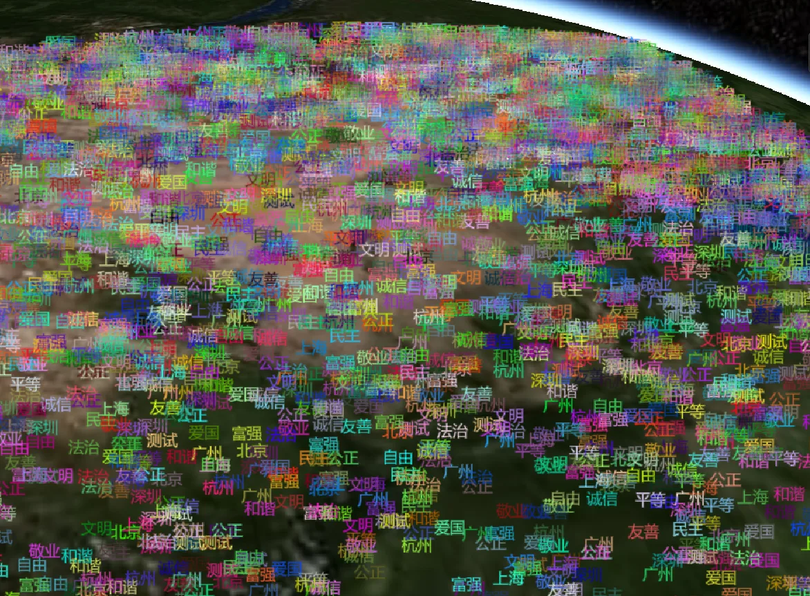
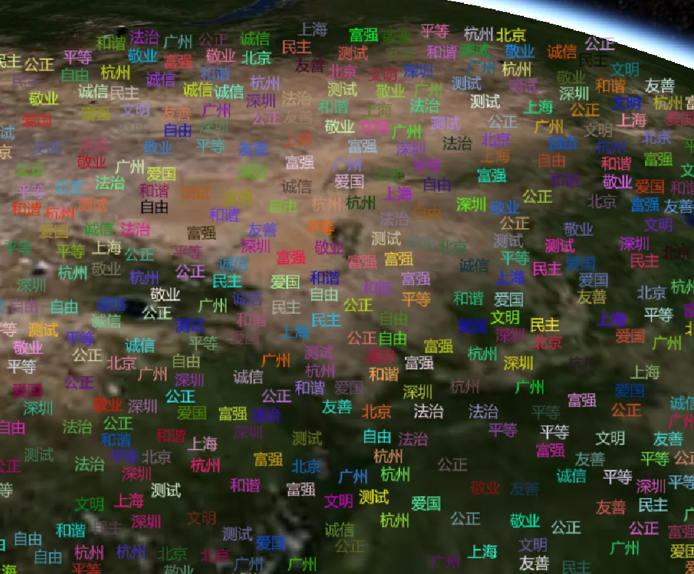

### 问题

在Cesium中，大场景小比例尺情况下POI进行文字标注时，会发生前后(上下)重叠遮盖的问题。如下所示：

文字标注过于密集，显示上重叠，难以清晰显示内容。如果我们给这些数据进行一个重叠遮挡检测计算，使得靠近相机的Label优先显示，被遮挡住的文字标注不显示，可以得到如下的清晰显示效果：

### 结果演示录屏

<video id="video" controls preload="metadata" poster="/assets/images/Cesium/avoidLabelOverlap-poster.webp" style="width: 100%;">
<source id="mp4" src="/assets/videos/Cesium/avoidLabelOverlap.mp4" type="video/mp4">
</video>
